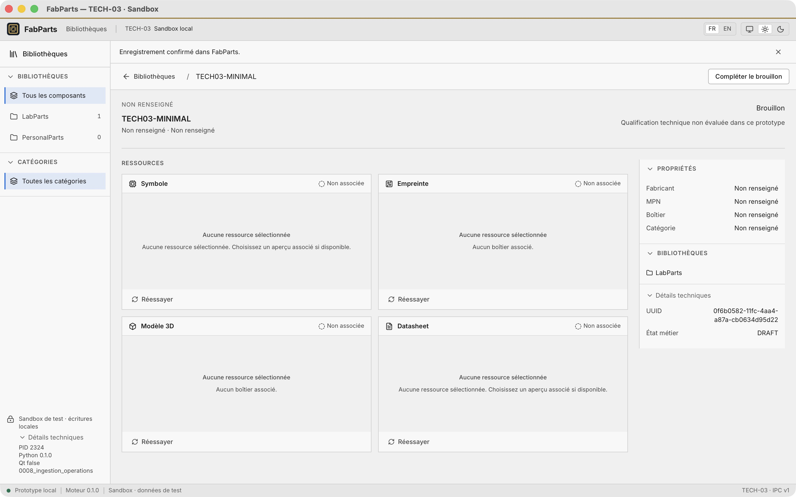
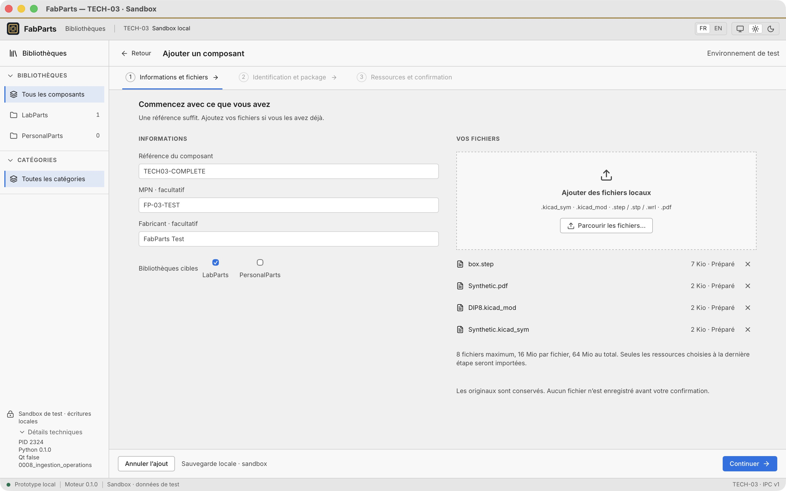
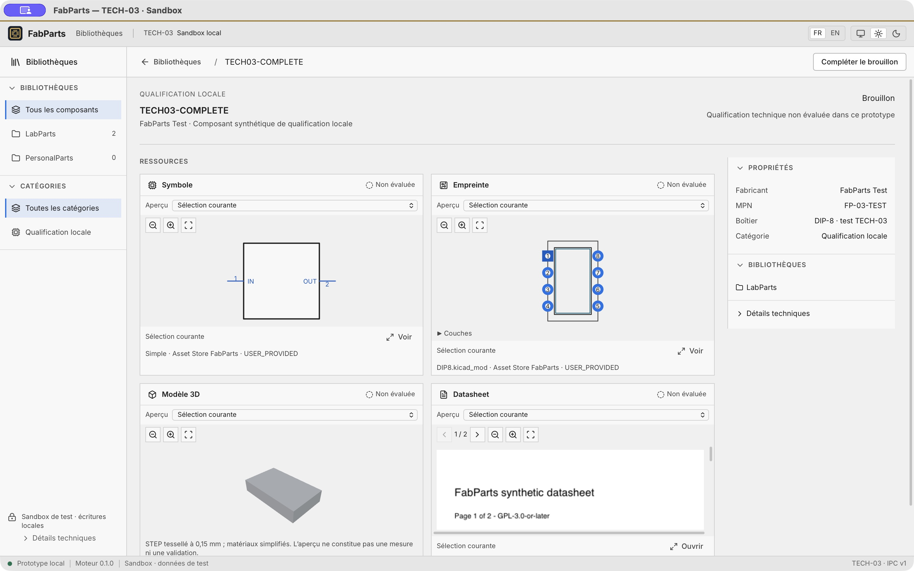
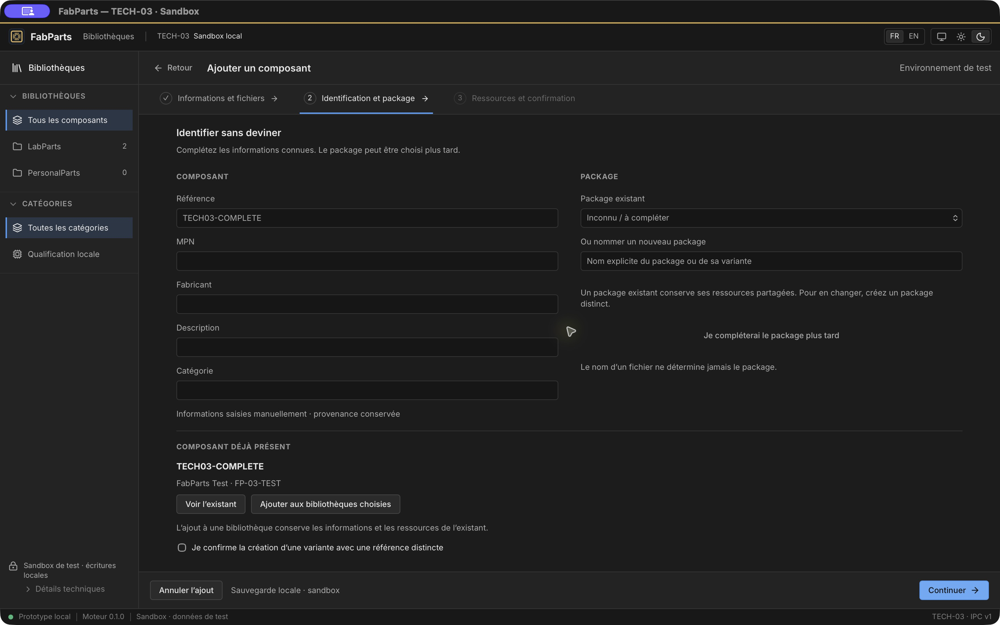
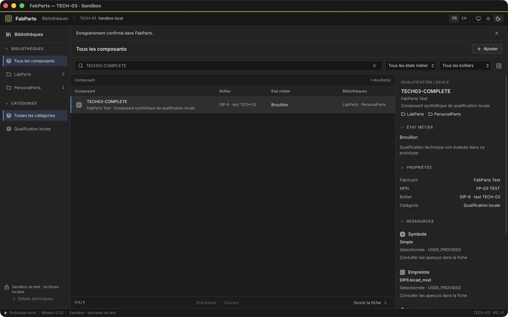
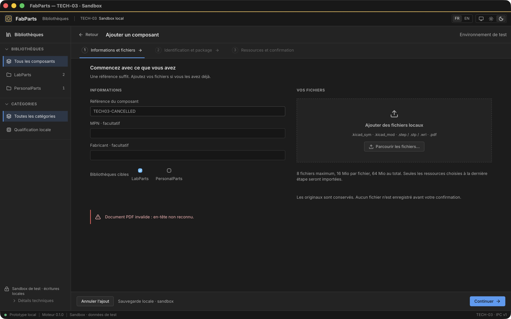
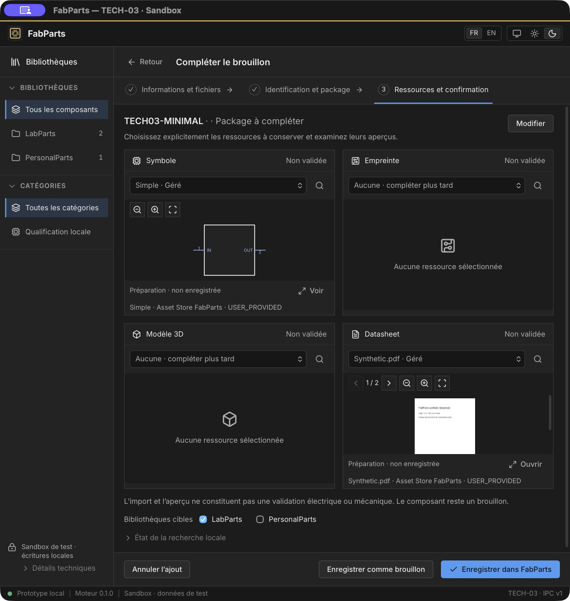
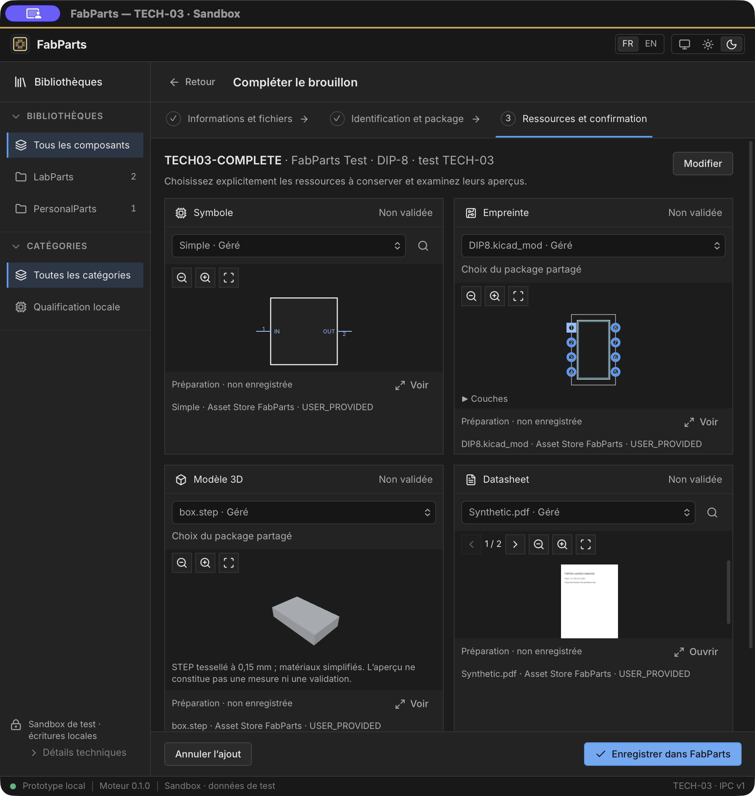
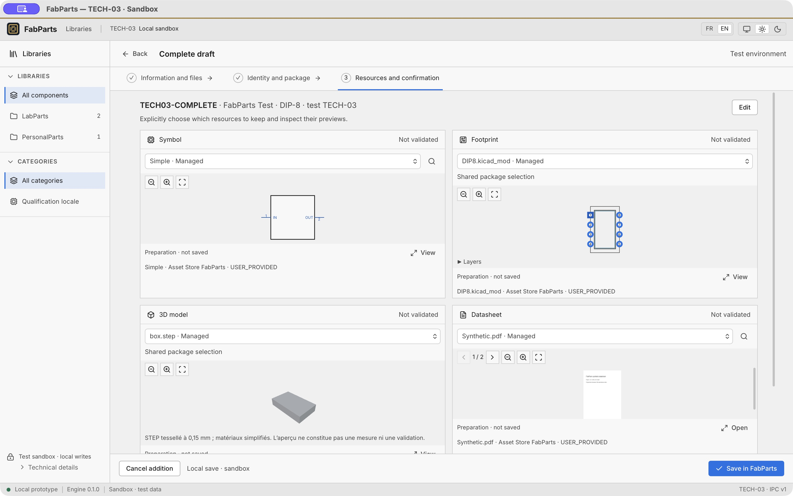

# FabParts 2.0 — TECH-03 : ingestion locale

Date : 25 octobre 2026. Branche : `tech/03-local-component-ingestion`.
Base : `main`, merge TECH-02B `ad8d1e1`.

**GO WITH CONDITIONS pour le sandbox macOS ARM64.** L'ingestion réelle,
la reprise des brouillons et la récupération des confirmations fonctionnent.
Les réserves concernent les diagnostics moteur encore en français, le périmètre
sandbox et les plateformes non qualifiées. Aucun défaut bloquant d'intégrité
n'a été observé.

## Audit et checkpoint architectural

Avant les écritures, l'audit a couvert Catalogue, AssetImports, LocalResolver,
Validation, CatalogueReader, Identification/Documentation, les adaptateurs SQL,
LocalAssetStore, le bootstrap headless et les lecteurs TECH-02.

| Existant réutilisé | Adaptation TECH-03 |
| --- | --- |
| Part, Package, Asset, Collection et règles d'association | Aucun nouvel état métier |
| Catalogue / SqliteCatalogue | Session empruntée pour composer une confirmation |
| AssetImports / LocalAssetStore | Même import, SHA-256, provenance et publication sans écrasement |
| Identification / SqliteDocumentation | Même stockage des champs et de leur provenance |
| LocalResolver / index KiCad | Recherche pour un propriétaire pas encore enregistré |
| CatalogueReader | Lectures fraîches sur SQLite writable |
| AssetPreviews / ReadonlyPreviews / ModelJobs | Présentation commune des snapshots préparés et canoniques |
| IPC JSONL v1 / transport Rust | Commandes additives et capacités natives |

Le checkpoint préalable a posé deux compositions distinctes, un staging borné,
une sauvegarde avant session, une transaction métier unique et un reçu durable.
L'extension est incrémentale ; la seule migration ajoute les reçus d'opération.
Voir [l'ADR 0003](adr/0003-writable-ingestion-sandbox.md).

## Modes, isolation et sauvegardes

Le readonly conserve `mode=ro&immutable=1`, `query_only`, l'authorizer,
les marqueurs de copie et l'interdiction des migrations. Il accepte les schémas
0007 et 0008 sans les modifier. Toute commande d'ingestion y est refusée.

Le writable exige un dossier neuf explicitement préparé, son marqueur
`TECH03_SANDBOX.json`, le schéma 0008 et un verrou exclusif. L'hôte fournit
`FABPARTS_SANDBOX_DIR` à Tauri, qui lance le sidecar avec `--sandbox`.
La WebView ne choisit ni ce mode ni un autre dossier writable, même lors d'un
redémarrage. SQLite ordinaire sert aux lectures comme aux écritures ; aucune
connexion immutable ne lit la base en mutation.

La préparation et la restauration sont des commandes d'administration, hors
WebView. Le sidecar empaqueté ne migre jamais. Les racines de production macOS,
les copies readonly, les symlinks, fichiers spéciaux et liens physiques extérieurs
sont refusés. Un lien physique entièrement interne laissé par une publication
Asset Store interrompue est accepté pour permettre la reprise. Le marqueur évite
une ouverture accidentelle ; il n'isole pas d'un utilisateur local malveillant
ayant déjà les mêmes droits disque.

Chaque ouverture writable vérifie schéma et SQLite, sauvegarde la base par
`sqlite3.backup`, copie assets/configuration, puis nettoie les seules préparations
temporaires reconnues. Les sauvegardes sont conservées. Restaurer vérifie
l'intégrité et copie vers un **nouveau** sandbox, sans écraser la source.

Depuis la racine du dépôt, avec un environnement Python de développement :

```sh
PYTHONPATH=src .venv/bin/python -m kipartmanager.sandbox --create "$PWD/local-data/tech03-demo"
PYTHONPATH=src .venv/bin/python -m kipartmanager.headless --sandbox --data-dir "$PWD/local-data/tech03-demo"
```

Pour restaurer, ajouter `--restore-from CHEMIN_SAUVEGARDE` à la première
commande et choisir une nouvelle destination. Pour l'application empaquetée :

```sh
FABPARTS_SANDBOX_DIR="$PWD/local-data/tech03-demo" \
  "prototypes/fabparts-tech-01/src-tauri/target/release/bundle/macos/FabParts TECH-01.app/Contents/MacOS/fabparts-tech-01"
```

## IPC et sélection native

Le protocole reste JSONL v1, corrélé et borné. Rust conserve processus,
autorisations, transport et capacités ; Python décide du métier.

| Commande | Rôle |
| --- | --- |
| `ingestion_begin` | Commencer ou reprendre un DRAFT, émettre préparation et opération |
| `ingestion_inspect` | Doublons et choix du package existant |
| `ingestion_search` | Candidats préparés, gérés et officiels locaux |
| `ingestion_preview` | Viewers TECH-02 avant confirmation |
| `ingestion_remove` | Retirer un fichier préparé et révoquer ses candidats |
| `ingestion_commit` | Confirmation atomique, variante ou appartenance |
| `ingestion_result` | Retrouver le reçu durable d'une opération |
| `ingestion_cancel` | Nettoyer uniquement la préparation concernée |

La WebView reçoit deux permissions additives : `ingestion_command` typée et
`choose_ingestion_files`. Les messages internes
`ingestion_file_start/chunk/finish/discard` sont produits par Rust, jamais
exposés à JavaScript comme transport générique. Aucun SQL, shell, accès filesystem
ou dialogue générique n'est accordé à la WebView.

Le sélecteur natif accepte symbole, empreinte, STEP/STP, WRL et PDF. Rust vérifie
chemin canonique sans symlink, fichier régulier, extension, taille et stabilité
de l'identité/taille/dates pendant lecture. Il ouvre sans suivi de lien, transmet
des blocs de 8 Kio et calcule SHA-256. Python vérifie ordre, longueur, hash et
contenu avec les lecteurs existants. Le frontend reçoit nom, taille, hash et
handles opaques ; aucun chemin source personnel n'est persisté.

Bornes : une préparation active, 20 minutes, huit fichiers, 16 Mio par fichier,
64 Mio cumulés, 256 candidats en cache. Confirmation : 30 s ; autres appels :
8 s. Les bornes PDF/3D TECH-02 restent actives, avec registres séparés.
Annulation, confirmation et redémarrage révoquent les capacités de préparation
concernées. Les réponses tardives sont écartées.

## Import, transaction et récupération

Prévisualiser crée seulement des fichiers temporaires privés au sandbox,
sans nouvelle Part ni Asset canonique. Les parseurs et convertisseurs TECH-02
sont réutilisés.

À confirmation, Ingestion compose les services existants dans une même Session
SQLAlchemy sous `BEGIN IMMEDIATE` : Part/Package, Assets, associations, choix,
métadonnées, collections et reçu. Les adaptateurs empruntant la session font des
flush, pas des commits indépendants. Leurs autres usages conservent leurs
transactions unitaires.

AssetImports/LocalAssetStore assurent provenance USER_PROVIDED, nom original,
SHA-256, vérification, déduplication physique et absence d'écrasement. Des Assets
logiques distincts peuvent partager un blob. Les sources restent intactes et
leur suppression ultérieure n'affecte pas les fichiers importés.

Les blobs sont publiés avant commit SQLite. Une interruption peut laisser un
blob orphelin, jamais une Part partiellement confirmée. Aucun nettoyage automatique
de blobs canoniques n'est ajouté. L'annulation nettoie uniquement sa préparation.

Le reçu 0008 contient UUID d'opération, hash de requête et Part. Le rejeu exact
renvoie le même résultat ; une autre requête avec cet UUID est refusée.
L'interface mémorise l'opération avant l'appel, bloque le double clic et interroge
le reçu après erreur/timeout, y compris après redémarrage. Elle ne réessaie pas
aveuglément et n'annonce « Enregistré » qu'après confirmation effective.
Une préparation non enregistrée est temporaire ; un DRAFT enregistré est durable.

## Identité, doublons, packages et métadonnées

La référence seule suffit. MPN, fabricant, description, catégorie, package et
fichiers sont facultatifs ; une identité explicite reste requise. Une référence
vide ou composée d'espaces utilise le MPN saisi. Les champs d'identification
conservent leur provenance utilisateur via les services existants. La catégorie
est manuelle, avec propositions issues du catalogue commun aux bibliothèques,
sans taxonomie parallèle ni reconnaissance de PDF prétendue.

Les doublons sont comparés par référence normalisée ou MPN normalisé, avec
fabricant lorsqu'il est connu. La normalisation traite espaces et casse,
sans rapprochement flou. Une identité potentielle offre consultation, ajout
d'appartenances ou variante explicitement confirmée avec référence distincte.
La vérification est répétée sous transaction. L'ajout à une collection conserve
la même Part et ses métadonnées ; la liste globale garde une ligne.

Modèle préservé : Part → Symbol/Datasheet, Package → Footprint/Model 3D.
Un package existant est sélectionnable mais ses ressources ne sont pas modifiées
par cet assistant. Un autre ensemble mécanique exige un package distinct nommé
explicitement. Aucun package n'est déduit d'un nom de fichier.

La recherche présente fichiers fournis, puis assets gérés, puis références
officielles locales. Ce classement ne sélectionne rien à la place de l'utilisateur.
Les références officielles peuvent rester externes ; aucun import massif ni
écriture dans KiCad. L'absence d'index est visible et n'empêche pas l'import manuel.

La reprise est réservée aux DRAFT. Elle restaure champs et choix, détecte les
modifications concurrentes et sauvegarde exactement les appartenances cochées.
Remplacer une ressource importe un nouvel Asset et change le choix sans
réécrire l'ancien blob. Un import reste UNCHECKED ; la Part reste DRAFT, même
avec quatre ressources. Présence, sélection, qualification et publication
ne sont pas confondues.

## TECH-03A — résultats backend

Backend démontré avant connexion du wizard : premier checkpoint 490 tests
réussis, trois tests FreeCAD explicitement désactivés dans cette exécution,
Ruff et mypy réussis. La qualification finale active aussi FreeCAD.

Les 21 tests dédiés utilisent de vrais SQLite et Asset Stores. Ils couvrent :
identité et métadonnées, quatre fichiers et previews préparés, sources supprimées,
déduplication physique, doublons/variantes/multi-collections, package partagé,
ressources gérées/officielles, brouillon partiel, modifications concurrentes,
capacités révoquées, contenu invalide/modifié/manquant, quotas, expiration,
readonly, second writer, migration, sauvegarde et restauration.

Les erreurs injectées avant import et avant reçu annulent la transaction.
Un sous-processus termine réellement par `os._exit(23)` avant commit :
aucune Part/Asset/reçu n'est engagé, seul le blob publié subsiste.
Un autre processus est tué après commit : Part et reçu sont retrouvés au
redémarrage. Les rejeux et une erreur de stockage ENOSPC sont couverts.

## TECH-03B — wizard connecté et preuves natives

Le shell, les styles et les trois étapes UX 02 sont conservés. Tauri n'importe
aucune fixture métier du prototype autonome. Svelte présente les DTO Python,
recueille les choix et recharge bibliothèques, liste et fiche après confirmation.
Les filtres sont remis dans un état permettant de retrouver la Part sauvegardée.
Les cartes offrent sélection explicite, provenance, aperçus et avertissements ;
la grille compacte conserve une page PDF cadrée entière.

Essais réalisés dans l'application empaquetée avec des données synthétiques :

| Scénario | Résultat constaté |
| --- | --- |
| TECH03-MINIMAL, référence seule | DRAFT dans LabParts, zéro Asset |
| TECH03-COMPLETE, quatre fichiers choisis nativement | Symbole, empreinte, STEP et PDF prévisualisés avant confirmation |
| Avant confirmation complète | Seulement le DRAFT minimal et zéro Asset en base |
| Confirmation puis suppression des quatre sources jetables | Quatre Assets/blobs, indépendants des sources |
| Fermeture et nouveau processus | Deux Parts et quatre aperçus gérés retrouvés |
| Même référence, ajout à PersonalParts | Une Part, deux appartenances, une ligne globale |
| Reprise complète et annulation | Champs/choix restaurés, package partagé protégé |
| PDF invalide et sélecteur annulé | Refus lisible, aucune Part/Asset supplémentaire |
| Reprise du DRAFT minimal avec symbole et PDF gérés | Sauvegardé sans package ni blob supplémentaire |
| Clair/sombre, FR/EN, fenêtre à 900 px | Actions et quatre cartes utilisables, sans débordement horizontal |
| Fermeture finale | Préparation nettoyée, application et sidecar arrêtés proprement |

L'import natif complet utilise STEP. WRL est couvert par les tests d'ingestion
et géométriques ; il n'est pas présenté comme un second import natif TECH-03.
Les erreurs de stockage et interruptions brutales sont des preuves automatisées,
distinctes des captures.

### Captures natives

Neuf fichiers JPEG réels avec extension `.jpg` :



















## Tests et packaging

| Vérification finale | Résultat |
| --- | --- |
| `QT_QPA_PLATFORM=offscreen FABPARTS_TEST_FREECAD=1 PYTHONPATH=src .venv/bin/pytest -q` | **499 passed**, 39,70 s |
| `.venv/bin/ruff check src tests` | Réussi |
| `.venv/bin/ruff format --check src tests` | 170 fichiers conformes |
| `.venv/bin/mypy` | 168 fichiers source/tests, aucune erreur |
| Rust `cargo +1.90.0 test --locked` | **25 passed** |
| Rust `cargo +1.90.0 fmt --check` | Réussi |
| TECH frontend `npm run check`, `npm test`, `npm run build` | 0 erreur/avertissement Svelte, **43 passed**, build réussi |
| UX autonome, mêmes commandes | 0 erreur/avertissement Svelte, **12 passed**, build réussi |
| PyInstaller puis Tauri `--bundles app -- --locked` | Bundle macOS ARM64, 28,21 Mio |
| Smoke empaqueté readonly | Lecture/recherche/fiche/arrêt OK, copie inchangée, Qt absent |
| Smoke empaqueté writable sans environnement Python transmis | Création, rejeu, redémarrage/reçu, doublon avec référence blanche et reprise d'appartenances OK ; deux sauvegardes conservées |
| Liens Markdown, formats des captures, `git diff --check` | Réussis |

Les commandes frontend s'exécutent dans leurs prototypes respectifs ; Cargo
dans `prototypes/fabparts-tech-01/src-tauri`. Construction depuis la racine :

```sh
RUSTUP_TOOLCHAIN=1.90.0 sh prototypes/fabparts-tech-01/scripts/build-sidecar.sh
(cd prototypes/fabparts-tech-01 && RUSTUP_TOOLCHAIN=1.90.0 npm run tauri -- build --bundles app -- --locked)
```

Le bundle n'embarque pas PySide6 ni Alembic. Il est local, non signé ; aucune
release n'est créée. Le warning Vite de taille du chunk PDF/Three demeure.
FreeCAD est un outil local externe facultatif pour STEP.

## Intégrité et protection des données

Sandbox natif final : deux Parts DRAFT, quatre Assets, quatre blobs avec SHA-256
conformes aux noms canoniques, quatre reçus ; `integrity_check=ok`, aucune
violation de clé étrangère, aucune préparation restante et trois sauvegardes
de démarrage conservées.

Les inventaires privés avant/après confirment les mêmes chemins et SHA-256 :
production **9 fichiers**, copie TECH-01 **10**, corpus TECH-02A **13**,
corpus TECH-02B **20**. Aucun de ces catalogues ni aucune sauvegarde existante
n'a changé. Bases, logs, inventaires et exécutables de qualification restent
ignorés par Git ; seules les captures synthétiques sont publiées.

## Critères, limites et décision

Les vingt critères sont couverts dans le périmètre annoncé : séparation des modes ;
création réelle ; DRAFT incomplet ; métadonnées ; package optionnel ; import géré ;
rôles ; quatre previews ; redémarrage ; multi-collections ; doublons ; recherche
locale ; rollback ; idempotence ; provenance ; états honnêtes ; protection de
la production ; non-régression ; inspection native ; absence de nouvelle
synchronisation/publication KiCad.

Réserves explicites :

- Écriture uniquement dans les sandboxes préparés ; aucune ouverture writable
  ni migration du catalogue personnel n'est autorisée par TECH-03.
- macOS ARM64 seul qualifié. Le verrou exige POSIX ; Windows est refusé,
  Linux n'a pas été inspecté. Pas de distribution signée.
- Nouveaux contrôles FR/EN ; certains diagnostics Python et avertissements
  géométriques hérités restent en français.
- Sélecteur natif disponible ; glisser-déposer différé. Une préparation
  non enregistrée expire ou disparaît au redémarrage.
- Les identités incomplètes ne prouvent pas l'unicité. La sérialisation protège
  ce parcours ; aucune contrainte globale n'est imposée aux adaptateurs historiques.
- Pas de collecte des blobs orphelins ni de purge des sauvegardes. Leur croissance
  demande une future politique explicite préservant les données.
- Coût des petites listes inchangé ; pas d'optimisation de grands catalogues
  ni de transaction distribuée SQLite/filesystem.
- STEP dépend de FreeCAD local. Les limites de parseurs, unités WRL et aperçu
  partiel décrites dans TECH-02 restent applicables.
- Assets UNCHECKED et Parts DRAFT. Qualification complète, publication KiCad,
  réseau et IA ne sont pas connectés par ce jalon.

**GO WITH CONDITIONS** : ingestion locale utilisable et vérifiée dans le sandbox,
avec les réserves ci-dessus à conserver lors de la revue Product Owner.
Branche destinée à une PR vers `main`, sans merge ni release automatique.
TECH-03 s'arrête à ce checkpoint.
