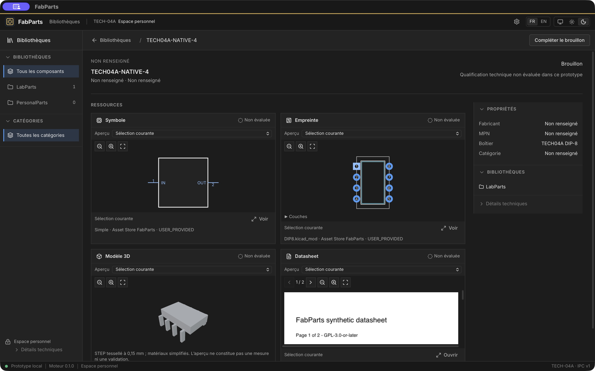

# FabParts 2.0 — TECH-04A : Persistent User Workspace & Data Safety

Date : 26 octobre 2026. Base : TECH-03 fusionné, `a0c850a`.
Branche : `tech/04a-user-workspace`.

## Résultat

**GO WITH CONDITIONS** sur macOS ARM64 : premier lancement personnel, ingestion,
persistance, snapshot complet, restauration dans une génération neuve et migration
0007 → 0008 vérifiés. Aucun nouveau schéma ni workflow de qualification/publication.

Le host sans arguments ouvre `~/Library/Application Support/FabParts`. Il crée
un espace neuf marqué avec les bibliothèques par défaut. Aucun import historique.
Le dossier personnel porte un verrou exclusif et `active.json` désigne une
génération UUID. La WebView ne choisit aucun chemin writable. Les modes explicites
sandbox et readonly restent distincts ; ce dernier conserve immutable/query_only,
son authorizer et l'absence de migration.

## Architecture et inventaire

Réutilisation de Catalogue, Ingestion, SQLite/SQLAlchemy, Asset Store et Alembic.
`headless.py` injecte l'initialisation des bibliothèques ; Infrastructure ne dépend
pas d'Application. Le service `workspace_backup.py` est partagé avec le sandbox.
Voir [ADR 0004](adr/0004-personal-workspace-and-verified-backups.md).

Le snapshot contient `catalogue.sqlite3` (métadonnées et reçus durables), `assets/`
(blobs canoniques et orphelins conservés), `config/`, `publications/` (manifestes,
COMMIT et inputs retenus), plus un manifeste versionné SHA-256/taille. Les blobs
référencés et publications sont également vérifiés. Un contenu persistant inconnu
fait refuser la sauvegarde. `index/` est un cache reconstruisible ; préparations
non enregistrées et `.staging` sont transitoires. Les préférences de présentation
WebView ne font pas autorité et ne sont pas incluses. Les anciens backups ne sont
pas récursivement sauvegardés, mais restent conservés.

SQLite est copié avec `sqlite3.backup`. Le snapshot est construit sous
`.partial-UUID`, vérifié, puis renommé. Les backups partiels, altérés, incomplets,
liés ou incompatibles sont refusés. Aucune purge et aucun backup complet au
redémarrage courant.

## Restauration et migrations

Le sélecteur natif fournit une source au backend ; seul un identifiant opaque
revient à la WebView. Confirmation native attachée à la fenêtre, re-vérification
de la source, backup de sécurité de l'actif, copie vérifiée vers `.restoring-UUID`,
renommage puis remplacement atomique d'`active.json`. L'ancienne génération et son
backup restent présents. Écritures bloquées jusqu'au redémarrage explicite.

Seule la migration additive Alembic 0007 → 0008 est autorisée, précédée d'un
snapshot complet vérifié. Intégrité SQLite, clés étrangères et version finale
contrôlées. Schémas inconnus/futurs refusés sans modifier le catalogue. Aucune
migration en readonly ni dans le sandbox. Alembic et ses scripts sont inclus dans
le sidecar empaqueté ; Qt reste exclu.

## Vérifications automatisées

- Python complet : **520 réussis, aucun ignoré**, avec `FABPARTS_TEST_FREECAD=1`.
- Rust : **26 réussis** (`cargo +1.90.0 test --locked`).
- Frontend TECH : **48 réussis** ; prototype UX : **12 réussis**.
- Svelte : **0 erreur, 0 avertissement** ; Ruff et mypy : succès (121 modules).
- Build PyInstaller et application Tauri macOS : succès. Avertissement Vite de
  taille de chunk conservé ; aucun changement des dépendances déclarées.

Les 21 tests du workspace couvrent premier démarrage sans variable, bibliothèques,
création et reçus, redémarrage sans backup supplémentaire, quatre aperçus après
restauration, configuration et vraie publication avec dépendances, migration
précédée d'une vérification, versions futures, permissions, double lancement,
liens, blobs manquants, corruption, disque plein simulé et sorties réelles de
processus pendant la copie ou à l'entrée de migration. Les partiels restent
inactifs et le verrou OS est libéré. Les suites readonly/IPC/ingestion existantes
passent. Les interruptions à chaque instruction Alembic et les coupures physiques
d'alimentation ne sont pas une qualification réalisée par ces tests.

## Vérification native macOS — Computer Use

Paquet release et sidecar embarqué, sur données synthétiques isolées via le
paramètre host de qualification `FABPARTS_USER_DATA_DIR` :

1. Premier démarrage, création `TECH04A-NATIVE-4`, nouveau package et quatre
   ressources choisies au sélecteur macOS : symbole, empreinte, STEP et PDF.
2. Prévisualisations natives vérifiées ; sauvegarde complète affichée comme vérifiée.
3. Fermeture coopérative du sidecar (exit 0), réouverture : composant et reçus présents.
4. Sélection de la sauvegarde, vérification, confirmation macOS, restauration vers
   une nouvelle génération, contrôles disabled puis redémarrage explicite du moteur.
5. Composant et **quatre aperçus retrouvés**, dont STEP FreeCAD et PDF multipage.
   Deux générations : chacune 1 Part, 4 AssetFiles et 1 reçu. Les quatre blobs
   SHA-256 sont identiques ; SQLite integrity_check est `ok`.
6. Paramètres FR/EN, thèmes clair/sombre, focus clavier, chemins longs et fenêtre
   réduite inspectés (environ 1440×900 puis 1050×700 points).

Une relance automatique de l'outil d'inspection après fermeture a ouvert le mode
par défaut et créé un dossier FabParts vide (0 Part). Ce dossier a été conservé
avec les données jetables, puis l'absence initiale du dossier système FabParts a
été rétablie. Le catalogue historique n'a jamais été ouvert writable. Inventaire
final des **9 fichiers historiques identique octet pour octet/SHA-256** à l'inventaire
initial. Aucun fichier de données, journal natif, binaire ou backup n'est committé.

## Limites et checkpoint

macOS ARM64 seul qualifié ; pas de distribution signée ni de qualification
Windows/Linux. Les snapshots et générations retenus demandent de l'espace disque.
Les opérations longues ont un délai host borné de 300 s ; un timeout n'est jamais
un succès et nécessite vérification/reprise. Une panne durant une migration peut
nécessiter une récupération administrative depuis le snapshot préalable ; aucun
écran de récupération indépendant d'un moteur démarrable n'est fourni. Les
empreintes garantissent l'intégrité, pas l'authenticité d'une source hostile.
Les limites locales des previews et la dépendance FreeCAD restent celles de TECH-02/03.

Documentation, sources et tests livrés pour revue vers `main`, sans merge.
Arrêt à TECH-04A ; TECH-04B n'est pas commencé.
